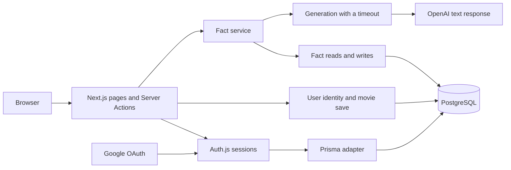
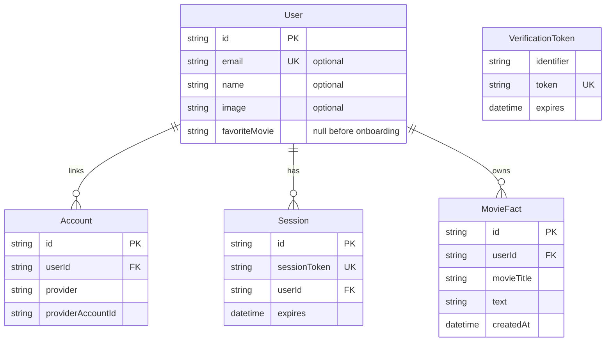
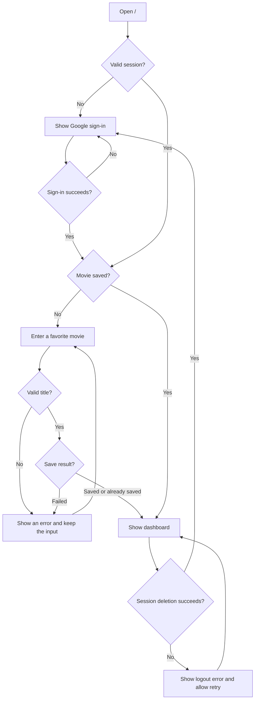
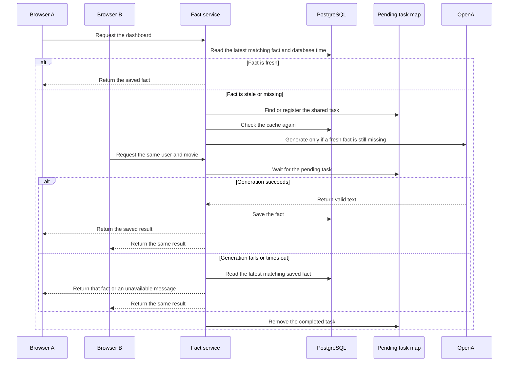

# Movie Memory implementation plan

## Scope

Movie Memory lets users sign in with Google, save a favorite movie, and read a fact about it.

This plan covers the base requirements and Variant A in `assessment.md`. Variant A adds server-side caching and failure recovery.

## Terms

| Term | Meaning |
| --- | --- |
| Session | A database record that identifies a signed-in user and has an expiry time. |
| Cache | A saved fact that the server can reuse without another OpenAI call. |
| Fresh fact | A saved fact that is less than 60 seconds old. |
| Stale fact | A saved fact that is at least 60 seconds old. |
| Request scope | One user ID and that user's saved movie title. |
| Shared promise | One pending task that several requests can wait for. |
| Server process | One running copy of the Node.js application. |

## Functional requirements

| ID | Requirement | Expected result |
| --- | --- | --- |
| FR-01 | Let visitors sign in with Google. | A signed-out visit to `/` shows “Sign in with Google.” The button starts Google OAuth. |
| FR-02 | Open the correct page after sign-in. | A user without a saved movie opens `/onboarding`. A user with a saved movie opens `/dashboard`. |
| FR-03 | Check the movie title on the server. | Remove leading and trailing spaces. Accept a title from 1 to 200 input units. Reject invalid input without saving it. |
| FR-04 | Save the movie for the signed-in user. | Save the title in PostgreSQL. Get the user ID from the session. Ignore user IDs supplied by the browser. |
| FR-05 | Save a favorite movie once. | Open the dashboard after a successful save. If two saves overlap, accept one title. Do not replace that title. |
| FR-06 | Show the user's dashboard. | Show the saved movie, Google name, email, photo, fact section, and logout button. Use clear fallbacks for missing profile data. |
| FR-07 | Generate and save a movie fact. | Send the saved title to OpenAI. Save a valid response before displaying it. Do not display test data as a generated fact. |
| FR-08 | Reuse a fresh fact. | Read the latest fact for the request scope. Reuse it below 60,000 milliseconds. Otherwise, attempt generation. |
| FR-09 | Share work between overlapping requests. | Requests for the same scope share one pending task in one server process. Requests for different scopes remain separate. |
| FR-10 | Handle an OpenAI failure. | Return the latest matching saved fact with a notice if generation fails. Show an unavailable message if no fact exists. |
| FR-11 | End the session on logout. | Delete the stored session before opening `/`. If deletion fails, show a retry message. Do not report successful logout. |
| FR-12 | Protect private pages and records. | Reject private access when the session is missing, expired, or deleted. Never return another user's movie or facts. |

The title limit uses JavaScript UTF-16 code units. Most letters use one unit. Some emoji use two units.

Exactly 60,000 milliseconds is outside the fresh cache window. A future-dated fact is not fresh.

The assessment requires first-time onboarding. It does not require a movie edit feature.

## Non-functional requirements

| ID | Requirement | Design response or check |
| --- | --- | --- |
| NFR-01 | Use the required stack. | Use Next.js, TypeScript, React, Tailwind, PostgreSQL, Prisma, Google OAuth, and OpenAI. Pin dependency versions in the lockfile. |
| NFR-02 | Protect user data and secrets. | Keep database and provider access on the server. Use parameterized queries. Exclude credentials from browser code, prompts, logs, and Git. |
| NFR-03 | Limit provider work. | Use no automatic retries. Apply a ten-second timeout and a 160-token output limit. Reject incomplete or filtered responses. |
| NFR-04 | Use consistent fact times. | Use database time for cache checks and saved timestamps. Treat stored fact times as UTC. Use a fixed order for timestamp ties. |
| NFR-05 | State the concurrency limit. | Protect overlapping requests in one server process. Document that separate processes need a shared database guard. |
| NFR-06 | Show useful application states. | Show pending, validation, unavailable, stale-fact, photo-failure, and recovery states. Keep the entered title after a rejected save. |
| NFR-07 | Support different users and screens. | Support keyboard use, visible focus, labels, reduced motion, long titles, and layouts from phones to 4K displays. |
| NFR-08 | Make the design easy to test and explain. | Separate identity, storage, generation, and page rendering. Give each module a clear role. Map requirements to tests. |
| NFR-09 | Support setup after cloning. | Include the migration, lockfile, and safe environment template. Provide setup and test steps in the final README. |
| NFR-10 | Review changes before publication. | Obtain approval for each commit and push. Show file comparisons, test results, and the exact commit message. Exclude private test reports. |

The ten-second timeout and 160-token limit are design choices. The assessment does not set those values.

## Proposed high level architecture

The browser sends input. The server checks the session and selects the user's records.

OpenAI receives the movie title as data. It receives no database tools, session tokens, or database credentials.

The application displays model output as text. It does not execute that output as SQL or JavaScript.

## Proposed data model

`PK` means primary key. `FK` means foreign key. `UK` means unique key.

- `User` stores the profile and favorite movie. A null movie means onboarding is incomplete.
- `Account` links a Google account to a user. The provider and provider account ID form a unique pair.
- `Session` stores a unique token and an expiry time. Deleting this record ends that session.
- `MovieFact` stores the owner, exact title, text, and creation time.
- `VerificationToken` supports the authentication library. Its identifier and token form a unique pair.

The fact index is `(userId, movieTitle, createdAt, id)`. It supports reads of the latest matching fact.

Deleting a user also deletes the linked accounts, sessions, and facts. The full field definitions belong in `prisma/schema.prisma`.

## Proposed user flow

A second save cannot replace an existing favorite. The server opens the dashboard with the saved title.

## Proposed fact request flow

The service registers a new task before it starts asynchronous work. It then checks the cache again to avoid unnecessary generation.

If Browser B arrives after the save, it reads the new cache record. It does not need the completed task.

A database save failure returns unavailable. The application does not display a generated fact before saving it.

Browser C keeps its displayed content until refresh. Automatic updates between browsers are outside this plan.

## Proposed module responsibilities

| File | Main functions | Responsibility |
| --- | --- | --- |
| `src/auth.ts` | `readSession`, `signOut` | Configure Google and database sessions. Keep authentication failures separate from signed-out results. |
| `src/lib/identity.ts` | `getCurrentUser`, `saveFavoriteMovie` | Read the signed-in user. Save the movie once for that user. |
| `src/lib/movie-input.ts` | `validateMovieTitle` | Trim and check the title. Share the length limit with the form. |
| `src/app/actions.ts` | `signInWithGoogle`, `saveMovie`, `signOutToHome` | Check form data. Call services. Return errors or page redirects. |
| `src/lib/facts.ts` | `getFactForCurrentUser` | Connect the identity, store, and provider modules. |
| `src/lib/fact-engine/service.ts` | `createFactService`, `isFresh` | Check the cache. Share pending work. Save results. Select a fallback. |
| `src/lib/fact-engine/store.ts` | `createFactStore` | Read and write facts for the user and exact movie. Use database time. |
| `src/lib/fact-engine/flights.ts` | `factFlights` | Keep the pending tasks for one server process. |
| `src/lib/fact-engine/generation.ts` | `generateWithinDeadline` | Enforce the timeout. Reject invalid output. Prevent late responses from saving results. |
| `src/lib/fact-engine/provider.ts` | `generateMovieFact` | Call OpenAI with the title, output limit, and cancellation signal. |
| `src/components/*` | Page views and forms | Display real user data and clear application states. |
| `src/app/globals.css` | Shared styles | Define colors, type, spacing, focus states, and responsive layouts. |

## Design choices and reasons

| Choice | Reason | Method |
| --- | --- | --- |
| Database sessions | Logout must end the stored session. | Use Auth.js with the Prisma adapter. Report a deletion failure before redirecting. |
| Server-side ownership checks | Browser input cannot establish the record owner. | Read the user ID from the session for each private operation. |
| Conditional movie save | Two submissions must not replace each other. | Update the user only when `favoriteMovie` is null. |
| Database clock | Different server clocks must not change the cache window. | Compare the saved timestamp with database time. Interpret fact times as UTC. |
| Shared pending task | Overlapping requests must avoid duplicate generation. | Store the full generation and save promise under the user ID and title. |
| Short database transactions | A slow provider must not hold a database transaction open. | Finish cache reads before the OpenAI call. Start the write after generation. |
| Saved-fact fallback | A provider failure should preserve useful content. | Read the latest matching saved fact after generation fails. |
| Warm cinema design | The app should feel personal and familiar. | Use ivory, olive, pale yellow, cinema imagery, and a ticket motif. |
| Local fonts and assets | The interface should not depend on remote font delivery. | Serve fonts and images from `public/`. Include source and license notes. |
| Responsive size units | Text must remain readable on large screens. | Scale text and spacing together. Use a single column on phones. |

## Setup after cloning

The completed repository must support the following process. The implementation batches and final setup guide must be complete first.

1. Clone the repository.
2. Install the documented Node.js and npm versions.
3. Run `npm ci`.
4. Copy `.env.example` to a private `.env` file.
5. Create the application database.
6. Configure the database connection.
7. Create a Google OAuth client.
8. Set the documented Google origin and callback URL.
9. Configure an OpenAI API key and model.
10. Generate the Prisma client.
11. Apply the checked-in migrations without resetting application data.
12. Start the application with the documented command.
13. Open `http://localhost:3000`.
14. Sign in with Google.
15. Save a favorite movie.
16. Check the dashboard.
17. Run the documented tests against a separate test database.

The setup must not require private files, copied sessions, or local tools from another checkout.

External accounts and credentials remain necessary. The final README must identify these prerequisites and provide the exact commands.

## Verification and release checks

- Map every requirement ID to source files and tests.
- Check the input limits, exact cache boundary, overlapping requests, and independent users.
- Test timeout, invalid output, failed saves, stale fallback, and failed logout.
- Run type checks, lint, and a production build.
- Run browser tests against a separate test database.
- Identify controlled test responses separately from live Google and OpenAI checks.
- Compare appearance and behavior at phone, laptop, and 4K sizes.
- Scan source, staged files, and browser assets for secrets.
- Exclude private configuration, real user records, and private test reports from Git.
- Review each batch before a commit or push.
- Prepare the README and AI-usage note in the final batch.

## Limits

The pending task map protects one server process. Multiple processes need a shared database guard.

Movie titles remain free text. Movie search, spelling correction, editing, and director matching are outside scope.

Generated facts can be inaccurate. The interface must state this limit.

Google photo delivery depends on an external service. The interface must show initials if the photo fails.

This plan does not include a production spending limit, persistent retry delay, or automatic browser updates.
